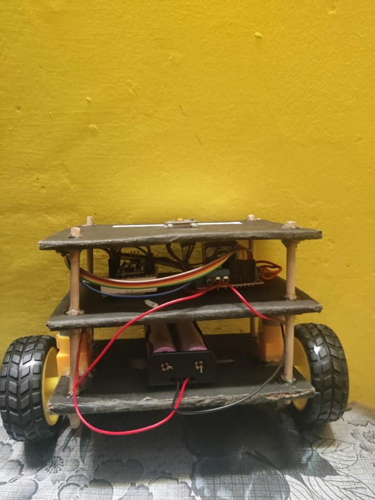
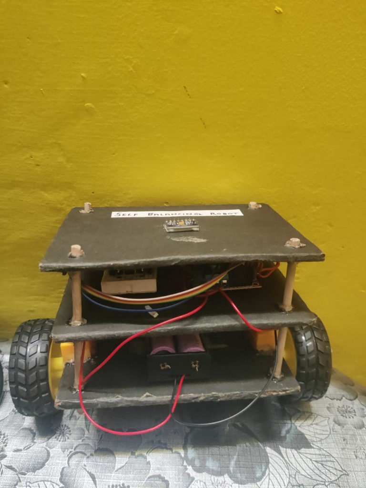
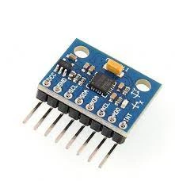
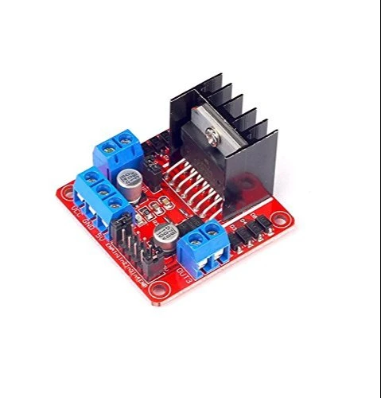
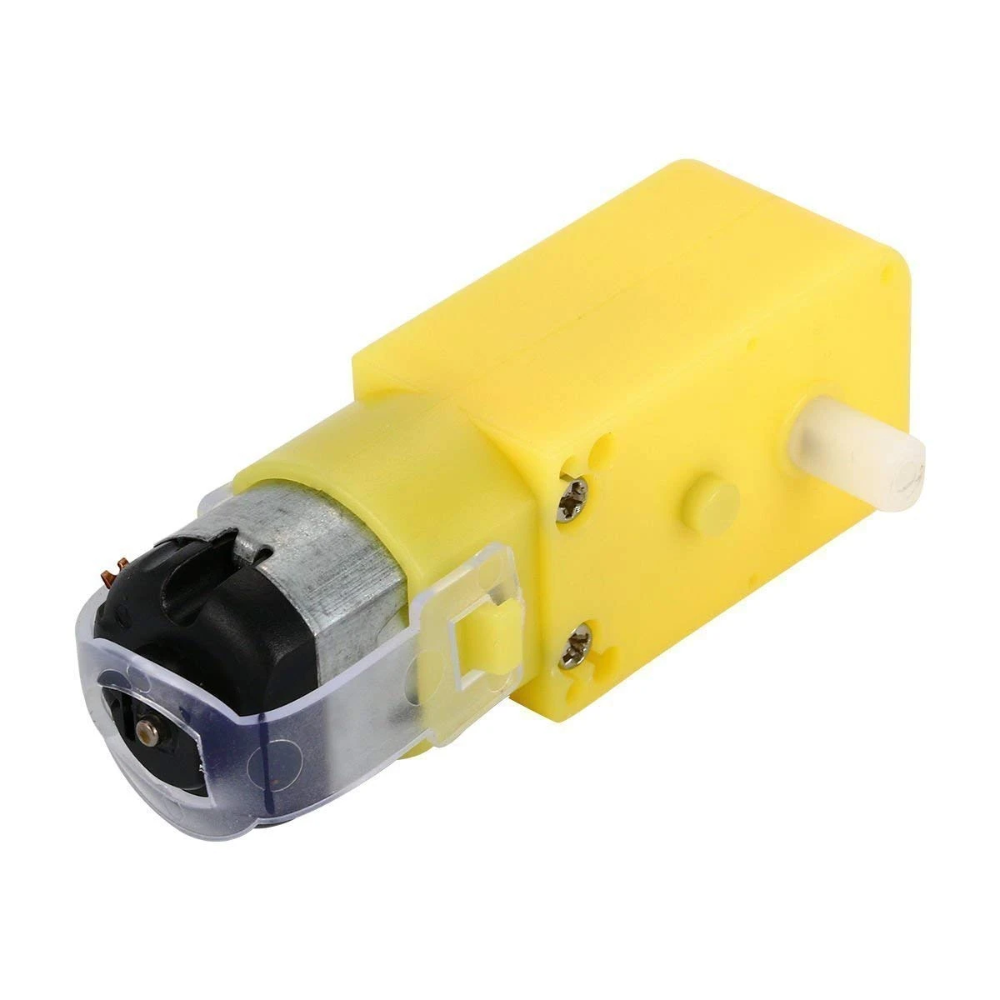
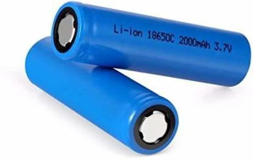

# Two-Wheeled Self-Balancing Robot 🤖

<p align="center">
  
  
</p>

[](https://www.arduino.cc/)
[](https://isocpp.org/)
[](LICENSE)
[]()

An open-source, affordable, and reproducible two-wheeled self-balancing robot built using an **Arduino Nano**, **MPU-6050 6-Axis IMU (with DMP)**, **L298N Dual H-Bridge motor driver**, and **BO gear motors**.

This project implements an inverted pendulum feedback loop with a real-time **Proportional-Integral-Derivative (PID)** control algorithm running at 100 Hz.

---

## 📸 Overview

```
                      +-----------------------------+
                      |       Center of Mass        |
                      |   (Batteries + Nano + IMU)  |
                      +--------------+--------------+
                                     |
                                     | Tilting (Error Angle)
                                     v
                           [ MPU-6050 Sensor ]
                                     | (I2C / DMP Interrupt)
                                     v
                            [ Arduino Nano ]
                                     |
                         [ PID Control Algorithm ]
                                     |
                                     v (PWM Signals)
                            [ L298N Driver ]
                                     |
                                     v
                       [ 2x BO Motors & Wheels ]
                           (Counter-torque)
```

---

## 🛠️ Hardware Bill of Materials (BOM)

| Component | Preview | Specification / Description | Quantity |
|---|:---:|---|---|
| **Microcontroller** |  | Arduino Nano (ATmega328P) | 1 |
| **Motion Sensor (IMU)** |  | MPU-6050 (3-axis Gyroscope + 3-axis Accelerometer) | 1 |
| **Motor Driver** |  | L298N Dual H-Bridge Motor Driver Module | 1 |
| **Motors & Wheels** |  | Dual-shaft BO Gear Motors (3V–6V DC) + 65mm Wheels | 2 |
| **Power Source** |  | 2x 18650 Li-ion rechargeable batteries (7.4V–8.4V total) | 2 |
| **Battery Holder** | — | 2-slot 18650 battery holder with leads | 1 |
| **Prototyping** | — | Mini Breadboard + Jumper Wires (Male-Male, Male-Female) | 1 |
| **Chassis** |  | 3-Tier DIY chassis plates with wooden/plastic standoffs | 1 |

---

## 🏗️ 3-Tier Chassis & Mechanical Assembly

The physical robot utilizes a sturdy 3-tier vertical stack connected via standoffs to provide optimal center-of-gravity distribution:

1. **Tier 1 (Base Platform):**
   * Two dual-shaft BO gear motors with brackets mounted on either side.
   * 65mm high-traction rubber wheels attached directly to the motor shafts.
   * 2-slot 18650 battery holder centered directly between the wheels for low-center-of-gravity stabilization and direct short-wire routing to the motor driver.

2. **Tier 2 (Electronics & Driver Bay):**
   * L298N Dual H-Bridge motor driver screwed or mounted firmly.
   * Mini breadboard seating the Arduino Nano.
   * Clean wire routing connecting the PWM/control pins to the Nano.

3. **Tier 3 (Sensor Deck):**
   * MPU-6050 6-Axis motion sensor mounted flat in the exact center of the top deck.
   * Level horizontal placement ensures zero tilt skew and clean pitch/roll angle computation by the DMP.

---

## 🔌 Circuit & Wiring Schematic

<p align="center">
  
</p>

### 1. MPU-6050 to Arduino Nano
| MPU-6050 Pin | Arduino Nano Pin | Note |
|---|---|---|
| **VCC** | **5V** (or 3.3V) | Power input |
| **GND** | **GND** | Ground |
| **SCL** | **A5** | I2C Clock (400kHz fast mode) |
| **SDA** | **A4** | I2C Data |
| **INT** | **D2** | External Interrupt (INT0) |

### 2. L298N Motor Driver to Arduino Nano
| L298N Terminal | Arduino Nano Pin | Note |
|---|---|---|
| **ENA** | **D5** (PWM) | Left motor speed control (remove jumper) |
| **IN1** | **D6** | Left motor direction |
| **IN2** | **D7** | Left motor direction |
| **IN3** | **D8** | Right motor direction |
| **IN4** | **D9** | Right motor direction |
| **ENB** | **D10** (PWM) | Right motor speed control (remove jumper) |

### 3. Power Distribution
* **18650 Pack (+) (Red)** $\rightarrow$ **12V terminal** on L298N
* **18650 Pack (-) (Black)** $\rightarrow$ **GND terminal** on L298N
* **L298N GND terminal** $\rightarrow$ **Arduino Nano GND** *(Mandatory common ground)*
* **L298N 5V OUT terminal** $\rightarrow$ **Arduino Nano 5V / VIN pin** (with L298N 5V regulator jumper attached)

> 💡 *See [docs/CIRCUIT_DIAGRAM.md](docs/CIRCUIT_DIAGRAM.md) for full schematic details and ASCII diagram.*

---

## ⚙️ PID Parameters & Balance Settings

The controller uses calibrated constants fine-tuned for two BO motors and a two-tier battery setup:

* **Setpoint:** `175.5°` *(Mechanical equilibrium tilt angle)*
* **$K_p$ (Proportional):** `51.0` *(Primary corrective force)*
* **$K_i$ (Integral):** `200.0` *(Steady-state drift compensation)*
* **$K_d$ (Derivative):** `2.8` *(Oscillation damping)*
* **Sample Time:** `10 ms` *(100 Hz loop refresh)*
* **Minimum Motor Speed:** `15` *(Overcomes BO motor static friction deadband)*

> 📘 *Need to adapt these for your chassis? Check out the [PID Tuning Guide](docs/PID_TUNING_GUIDE.md).*

---

## 📂 Repository Structure

```text
arduino-self-balancing-robot/
├── .gitignore                      # Git ignore rules for Arduino/C++
├── LICENSE                         # MIT Open Source License
├── README.md                       # Main documentation & build guide
├── docs/
│   ├── CIRCUIT_DIAGRAM.md          # Wiring schematics and power topology
│   ├── PID_TUNING_GUIDE.md         # Theory, math, and tuning walkthrough
│   ├── STEP_BY_STEP_GUIDE.md       # End-to-end hardware & software build manual
│   └── TROUBLESHOOTING.md          # Solutions for common pitfalls
├── libraries/                      # All pre-configured libraries used
│   ├── I2Cdev/
│   ├── LMotorController/
│   ├── MPU6050/
│   └── PID_v1/
└── src/
    └── SelfBalancingRobot/
        ├── SelfBalancingRobot.ino  # Main Arduino sketch
        ├── LMotorController.h     # Motor controller class definition
        └── LMotorController.cpp   # Motor controller implementation
```

---

## 🛠️ Complete Step-by-Step Project Guide

> 📖 *For the exhaustive guide with in-depth descriptions, read the [Complete Step-by-Step Build Guide](docs/STEP_BY_STEP_GUIDE.md).*

### Phase 1: Hardware & Software Requirements

#### Hardware Needed:
* **Microcontroller:** Arduino Nano (ATmega328P, 5V, 16MHz)
* **Sensor:** MPU-6050 6-Axis Accelerometer & Gyroscope module
* **Motor Driver:** L298N Dual H-Bridge Driver module
* **Motors & Wheels:** 2x Dual-shaft BO gear motors (3V–6V) + 2x 65mm rubber wheels
* **Power:** 2x 18650 Li-ion rechargeable batteries (7.4V nominal) + 2-slot battery holder
* **Chassis Materials:** 3x plates (acrylic / MDF / foam board approx. 15cm x 10cm) + 8x standoffs or dowels (~40mm)
* **Wiring:** Mini breadboard, jumper wires (M-M, M-F), hot glue or screws

#### Software & Drivers Needed:
* **Arduino IDE:** [Arduino IDE 1.8.x or 2.x](https://www.arduino.cc/en/software)
* **USB Driver:** [CH340 USB Driver](https://sparks.gogo.co.nz/ch340.html) (for Arduino Nano clones)
* **Libraries:** `PID_v1`, `I2Cdev`, `MPU6050`, `LMotorController` (all included in `/libraries`)

---

### Phase 2: Mechanical Chassis Assembly

1. **Tier 1 (Base Platform):**
   * Secure the two BO motors on either side of the base plate with the shafts pointing outward.
   * Attach the 65mm wheels.
   * Place the 2-slot 18650 battery holder centered directly between the wheels for low-center-of-gravity weight distribution.
2. **Tier 2 (Electronics Bay):**
   * Mount 4 standoffs/dowels to elevate Tier 2.
   * Fix the L298N driver and mini breadboard with the Arduino Nano.
3. **Tier 3 (Sensor Deck):**
   * Mount 4 standoffs above Tier 2 to support the top plate.
   * Affix the **MPU-6050 flat in the exact center** with double-sided foam tape. Ensure the orientation aligns with the robot's forward/backward axis.

---

### Phase 3: Electrical Wiring & Power

1. **Remove L298N ENA & ENB Jumpers:** Take off the black jumper caps so Arduino pins D5 and D10 can control motor speed via PWM.
2. **Wire L298N to Arduino Nano:**
   * `ENA` $\rightarrow$ `D5` (PWM) | `ENB` $\rightarrow$ `D10` (PWM)
   * `IN1` $\rightarrow$ `D6` | `IN2` $\rightarrow$ `D7`
   * `IN3` $\rightarrow$ `D8` | `IN4` $\rightarrow$ `D9`
3. **Wire MPU-6050 to Arduino Nano:**
   * `VCC` $\rightarrow$ `5V` | `GND` $\rightarrow$ `GND`
   * `SCL` $\rightarrow$ `A5` | `SDA` $\rightarrow$ `A4` | `INT` $\rightarrow$ `D2`
4. **Power Connections:**
   * Battery Pack (+) $\rightarrow$ L298N `12V` terminal
   * Battery Pack (-) $\rightarrow$ L298N `GND` terminal
   * L298N `GND` terminal $\rightarrow$ Arduino Nano `GND` (*Common Ground*)
   * L298N `5V` terminal $\rightarrow$ Arduino Nano `VIN` / `5V` pin (with L298N 5V regulator jumper attached)

---

### Phase 4: Software Setup & Library Installation

1. **Clone this repository:**
   ```bash
   git clone https://github.com/shivamdubey733/Self-Balancing-Robot-.git
   cd Self-Balancing-Robot-
   ```
2. **Install the Libraries:**
   Copy the four folders inside `libraries/` (`I2Cdev`, `LMotorController`, `MPU6050`, `PID_v1`) into your Arduino libraries folder:
   * **Windows:** `Documents\Arduino\libraries\`
   * **macOS:** `~/Documents/Arduino/libraries/`
   * **Linux:** `~/Arduino/libraries/`
3. Restart the Arduino IDE.

---

### Phase 5: Calibration & Firmware Upload

1. Open `src/SelfBalancingRobot/SelfBalancingRobot.ino` in Arduino IDE.
2. Connect your Arduino Nano via USB.
3. In Arduino IDE:
   * **Tools > Board > Arduino AVR Boards > Arduino Nano**
   * **Tools > Processor > ATmega328P** (or **ATmega328P (Old Bootloader)**)
   * **Tools > Port > Select your COM Port**
4. Click **Upload** (Ctrl + U).
5. **Motor Direction Verification ("Tumble Test"):**
   * Hold the robot in the air and switch on battery power.
   * Tilt forward $\rightarrow$ wheels must spin **forward**.
   * Tilt backward $\rightarrow$ wheels must spin **backward**.
   * *(If wheels spin in reverse, swap the motor output wires on L298N terminals OUT1/OUT2 or OUT3/OUT4).*

---

### Phase 6: First Balance Test & PID Tuning

1. Place the robot upright on a smooth, hard floor.
2. Power on the switch while holding the robot upright for **3–5 seconds** so the MPU-6050 DMP finishes gyroscope offset calibration.
3. Release gently—the robot will actively oscillate and balance!
4. **Fine-Tuning:**
   * Open Serial Monitor at `115200 baud` to view real-time angle and PID output.
   * If it shakes/twitches violently, lower $K_p$ (e.g. from 51 to 42) or lower $K_d$.
   * If it falls over slowly, increase $K_p$ (e.g. from 51 to 58).
   * If it drifts in one direction, adjust `originalSetpoint` (default: `175.5`) to match your physical center of mass.

---

## 🔍 Troubleshooting

| Issue | Quick Solution |
|---|---|
| **Robot rushes in one direction and falls** | Swap the motor polarity wires on L298N or swap `IN1`/`IN2` in code. |
| **DMP Initialization error** | Verify SDA $\rightarrow$ A4, SCL $\rightarrow$ A5, and INT $\rightarrow$ D2 wiring. |
| **Violent jittering / shaking** | Lower $K_p$ (e.g. from 51 down to 40) or lower $K_d$. |
| **Robot resets after 10 seconds** | Batteries have low charge; recharge both 18650 cells to 4.2V each. |

For detailed failure modes and diagnostics, consult [docs/TROUBLESHOOTING.md](docs/TROUBLESHOOTING.md).

---

## 📜 License

This project is licensed under the [MIT License](LICENSE) - free for educational, hobbyist, and commercial use.

## 👨‍💻 Author

**Shivam Dubey**
* GitHub: [@shivamdubey733](https://github.com/shivamdubey733)
* Email: [shivamkumardubey71@gmail.com](mailto:shivamkumardubey71@gmail.com)
