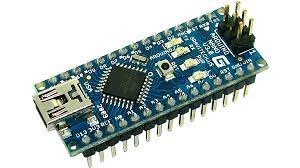
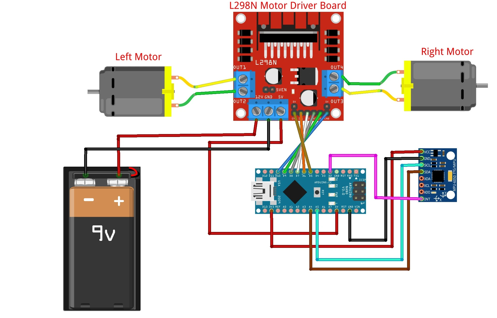

# Two-Wheeled Self-Balancing Robot 🤖

<p align="center">
  
  
</p>

[](https://www.arduino.cc/)
[](https://isocpp.org/)
[](LICENSE)
[]()

An open-source, affordable, and reproducible two-wheeled self-balancing robot built using an **Arduino Nano**, **MPU-6050 6-Axis IMU (with DMP)**, **L298N Dual H-Bridge motor driver**, and **BO gear motors**.

This project implements an inverted pendulum feedback loop with a real-time **Proportional-Integral-Derivative (PID)** control algorithm running at 100 Hz.

---

## 📸 Overview

```
                      +-----------------------------+
                      |       Center of Mass        |
                      |   (Batteries + Nano + IMU)  |
                      +--------------+--------------+
                                     |
                                     | Tilting (Error Angle)
                                     v
                           [ MPU-6050 Sensor ]
                                     | (I2C / DMP Interrupt)
                                     v
                            [ Arduino Nano ]
                                     |
                         [ PID Control Algorithm ]
                                     |
                                     v (PWM Signals)
                            [ L298N Driver ]
                                     |
                                     v
                       [ 2x BO Motors & Wheels ]
                           (Counter-torque)
```

---

## 🛠️ Hardware Bill of Materials (BOM)

| Component | Preview | Specification / Description | Quantity |
|---|:---:|---|---|
| **Microcontroller** |  | Arduino Nano (ATmega328P) | 1 |
| **Motion Sensor (IMU)** |  | MPU-6050 (3-axis Gyroscope + 3-axis Accelerometer) | 1 |
| **Motor Driver** |  | L298N Dual H-Bridge Motor Driver Module | 1 |
| **Motors & Wheels** |  | Dual-shaft BO Gear Motors (3V–6V DC) + 65mm Wheels | 2 |
| **Power Source** |  | 2x 18650 Li-ion rechargeable batteries (7.4V–8.4V total) | 2 |
| **Battery Holder** | — | 2-slot 18650 battery holder with leads | 1 |
| **Prototyping** | — | Mini Breadboard + Jumper Wires (Male-Male, Male-Female) | 1 |
| **Chassis** |  | 3-Tier DIY chassis plates with wooden/plastic standoffs | 1 |

---

## 🏗️ 3-Tier Chassis & Mechanical Assembly

The physical robot utilizes a sturdy 3-tier vertical stack connected via standoffs to provide optimal center-of-gravity distribution:

1. **Tier 1 (Base Platform):**
   * Two dual-shaft BO gear motors with brackets mounted on either side.
   * 65mm high-traction rubber wheels attached directly to the motor shafts.
   * 2-slot 18650 battery holder centered directly between the wheels for low-center-of-gravity stabilization and direct short-wire routing to the motor driver.

2. **Tier 2 (Electronics & Driver Bay):**
   * L298N Dual H-Bridge motor driver screwed or mounted firmly.
   * Mini breadboard seating the Arduino Nano.
   * Clean wire routing connecting the PWM/control pins to the Nano.

3. **Tier 3 (Sensor Deck):**
   * MPU-6050 6-Axis motion sensor mounted flat in the exact center of the top deck.
   * Level horizontal placement ensures zero tilt skew and clean pitch/roll angle computation by the DMP.

---

## 🔌 Circuit & Wiring Schematic

<p align="center">
  
</p>

### 1. MPU-6050 to Arduino Nano
| MPU-6050 Pin | Arduino Nano Pin | Note |
|---|---|---|
| **VCC** | **5V** (or 3.3V) | Power input |
| **GND** | **GND** | Ground |
| **SCL** | **A5** | I2C Clock (400kHz fast mode) |
| **SDA** | **A4** | I2C Data |
| **INT** | **D2** | External Interrupt (INT0) |

### 2. L298N Motor Driver to Arduino Nano
| L298N Terminal | Arduino Nano Pin | Note |
|---|---|---|
| **ENA** | **D5** (PWM) | Left motor speed control (remove jumper) |
| **IN1** | **D6** | Left motor direction |
| **IN2** | **D7** | Left motor direction |
| **IN3** | **D8** | Right motor direction |
| **IN4** | **D9** | Right motor direction |
| **ENB** | **D10** (PWM) | Right motor speed control (remove jumper) |

### 3. Power Distribution
* **18650 Pack (+) (Red)** $\rightarrow$ **12V terminal** on L298N
* **18650 Pack (-) (Black)** $\rightarrow$ **GND terminal** on L298N
* **L298N GND terminal** $\rightarrow$ **Arduino Nano GND** *(Mandatory common ground)*
* **L298N 5V OUT terminal** $\rightarrow$ **Arduino Nano 5V / VIN pin** (with L298N 5V regulator jumper attached)

> 💡 *See [docs/CIRCUIT_DIAGRAM.md](docs/CIRCUIT_DIAGRAM.md) for full schematic details and ASCII diagram.*

---

## ⚙️ PID Parameters & Balance Settings

The controller uses calibrated constants fine-tuned for two BO motors and a two-tier battery setup:

* **Setpoint:** `175.5°` *(Mechanical equilibrium tilt angle)*
* **$K_p$ (Proportional):** `51.0` *(Primary corrective force)*
* **$K_i$ (Integral):** `200.0` *(Steady-state drift compensation)*
* **$K_d$ (Derivative):** `2.8` *(Oscillation damping)*
* **Sample Time:** `10 ms` *(100 Hz loop refresh)*
* **Minimum Motor Speed:** `15` *(Overcomes BO motor static friction deadband)*

> 📘 *Need to adapt these for your chassis? Check out the [PID Tuning Guide](docs/PID_TUNING_GUIDE.md).*

---

## 📂 Repository Structure

```text
arduino-self-balancing-robot/
├── .gitignore                      # Git ignore rules for Arduino/C++
├── LICENSE                         # MIT Open Source License
├── README.md                       # Main documentation & build guide
├── docs/
│   ├── CIRCUIT_DIAGRAM.md          # Wiring schematics and power topology
│   ├── PID_TUNING_GUIDE.md         # Theory, math, and tuning walkthrough
│   └── TROUBLESHOOTING.md          # Solutions for common pitfalls
├── libraries/                      # All pre-configured libraries used
│   ├── I2Cdev/
│   ├── LMotorController/
│   ├── MPU6050/
│   └── PID_v1/
└── src/
    └── SelfBalancingRobot/
        ├── SelfBalancingRobot.ino  # Main Arduino sketch
        ├── LMotorController.h     # Motor controller class definition
        └── LMotorController.cpp   # Motor controller implementation
```

---

## 🚀 Quick Start Guide

### Step 1: Clone the Repository
```bash
git clone https://github.com/shivamdubey733/arduino-self-balancing-robot.git
cd arduino-self-balancing-robot
```

### Step 2: Install Libraries
Copy the folders from `libraries/` into your Arduino libraries folder:
* **Windows:** `Documents\Arduino\libraries\`
* **macOS:** `~/Documents/Arduino/libraries/`
* **Linux:** `~/Arduino/libraries/`

*(Alternatively, install `PID by Brett Beauregard` and `I2Cdevlib-MPU6050` from the Arduino Library Manager).*

### Step 3: Wire the Hardware
Follow the connection table above. Ensure that:
1. Jumper caps on **ENA** and **ENB** of the L298N driver are **removed**.
2. Common ground is established between L298N and Arduino Nano.
3. The MPU-6050 sensor is mounted firmly horizontally, centered between the wheels.

### Step 4: Flash the Firmware
1. Open `src/SelfBalancingRobot/SelfBalancingRobot.ino` in Arduino IDE.
2. Select **Tools > Board > Arduino Nano**.
3. Select Processor: **ATmega328P** (or **ATmega328P (Old Bootloader)** depending on your board).
4. Select your COM Port and click **Upload**.

### Step 5: Test & Balance
1. Place the robot upright on a smooth flat surface.
2. Power on the battery switch.
3. Keep the robot upright for 3–5 seconds while the MPU-6050 DMP finishes self-calibration.
4. Let go gently—the robot will actively correct its position to stay balanced!

---

## 🔍 Troubleshooting

| Issue | Quick Solution |
|---|---|
| **Robot rushes in one direction and falls** | Swap the motor polarity wires on L298N or swap `IN1`/`IN2` in code. |
| **DMP Initialization error** | Verify SDA $\rightarrow$ A4, SCL $\rightarrow$ A5, and INT $\rightarrow$ D2 wiring. |
| **Violent jittering / shaking** | Lower $K_p$ (e.g. from 51 down to 40) or lower $K_d$. |
| **Robot resets after 10 seconds** | Batteries have low charge; recharge both 18650 cells to 4.2V each. |

For detailed failure modes and diagnostics, consult [docs/TROUBLESHOOTING.md](docs/TROUBLESHOOTING.md).

---

## 📜 License

This project is licensed under the [MIT License](LICENSE) - free for educational, hobbyist, and commercial use.

## 👨‍💻 Author

**Shivam Dubey**
* GitHub: [@shivamdubey733](https://github.com/shivamdubey733)
* Email: [shivamkumardubey71@gmail.com](mailto:shivamkumardubey71@gmail.com)
