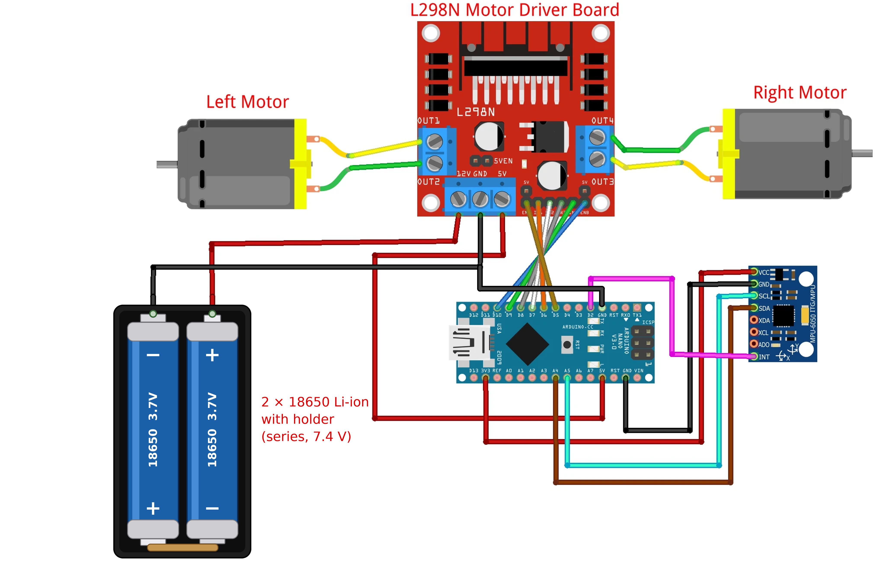

# Circuit Diagram & Hardware Connections

This document details the exact wiring schematic and power distribution for the Arduino Nano Self-Balancing Robot.

<p align="center">
  <a href="images/circuit_diagram.png" target="_blank">
    
  </a>
  <br>
  <sub>🔍 <em>Click the image to view or download in full 4K Ultra-HD (4112×2638) resolution.</em></sub>
</p>

---

## 1. Complete Pinout Table

### A. MPU-6050 (6-Axis IMU) to Arduino Nano
| MPU-6050 Pin | Arduino Nano Pin | Function / Description |
|---|---|---|
| **VCC** | **5V** (or 3.3V) | Module power supply |
| **GND** | **GND** | System ground |
| **SCL** | **A5** | I2C Serial Clock (Wire library) |
| **SDA** | **A4** | I2C Serial Data (Wire library) |
| **INT** | **D2** | External Interrupt (INT0 for DMP FIFO) |

> **Note:** The DMP firmware runs on the MPU-6050 and signals the Arduino on hardware interrupt pin **D2** whenever a fresh 42-byte motion packet is ready.

---

### B. L298N Dual H-Bridge to Arduino Nano
| L298N Pin | Arduino Nano Pin | Function / Description |
|---|---|---|
| **ENA** | **D5** (PWM) | Left Motor Speed Control |
| **IN1** | **D6** | Left Motor Direction 1 |
| **IN2** | **D7** | Left Motor Direction 2 |
| **IN3** | **D8** | Right Motor Direction 1 |
| **IN4** | **D9** | Right Motor Direction 2 |
| **ENB** | **D10** (PWM) | Right Motor Speed Control |

> **Crucial:** Remove the black jumper caps from **ENA** and **ENB** on the L298N board so that PWM pins D5 and D10 can regulate motor speed dynamically.

---

### C. Power Supply & Battery Distribution (2x 18650 Li-ion)
* **Battery Pack Voltage:** 2 × 3.7V = **7.4V nominal** (~8.4V fully charged).
* **Power Connection:**
  * **Battery (+) (Red):** Connects to the **12V terminal** of the L298N motor driver.
  * **Battery (-) (Black):** Connects to the **GND terminal** of the L298N motor driver.
  * **Common Ground:** Run a jumper wire from the L298N **GND terminal** to an **Arduino Nano GND** pin.
  * **Nano Power:** With the L298N onboard 5V regulator jumper enabled, run a wire from the L298N **5V terminal** to the **VIN pin** or **5V pin** of the Arduino Nano.

---

## 2. Text-Based Circuit Schematic

```
                          +-------------------------+
                          |   2x 18650 Batteries    |
                          |      (7.4V - 8.4V)      |
                          +------------+------------+
                                       |
                   (+) RED             |             (-) BLACK
        +------------------------------+-------------------------------+
        |                                                              |
        v                                                              v
+-------+---------------------+                         +--------------+------+
|       12V    GND    5V      |                         |                     |
|         L298N DRIVER        |                         |     MPU-6050        |
|  OUT1/2             OUT3/4  |                         |  VCC GND SCL SDA INT|
+----+---+-----------+----+---+                         +---+---+---+---+--+--+
     |   |           |    |                                 |   |   |   |  |
     |   |           |    |                                 |   |   |   |  |
  +--+---+--+     +--+---+--+                               |   |   |   |  |
  | Left BO |     | Right BO|                               |   |   |   |  |
  |  Motor  |     |  Motor  |                               |   |   |   |  |
  +---------+     +---------+                               |   |   |   |  |
                                                            |   |   |   |  |
      ENA IN1 IN2 IN3 IN4 ENB                               |   |   |   |  |
       |   |   |   |   |   |                                |   |   |   |  |
       |   |   |   |   |   |                                |   |   |   |  |
+------v---v---v---v---v---v--------------------------------v---v---v---v--v--+
|      D5  D6  D7  D8  D9  D10                             5V  GND  A5  A4 D2 |
|                                                                             |
|                                ARDUINO NANO                                 |
+-----------------------------------------------------------------------------+
```

---

## 3. Important Assembly & Wiring Checkpoints

1. **Common Ground is Mandatory:** If the Arduino and L298N grounds are not linked, the motor control signals will float, causing erratic twitching or unresponsiveness.
2. **Motor Direction Test:** If your robot accelerates away and falls instead of moving underneath itself to catch balance, swap the motor output terminals (`OUT1`/`OUT2` or `OUT3`/`OUT4`), or invert the IN1/IN2 logic in the code.
3. **MPU-6050 Placement:**
   * Mount the sensor as close to the wheel axle (center of rotation) as possible.
   * Ensure it is mounted firmly. Any vibration or slack will inject noise into the DMP pitch estimate.
